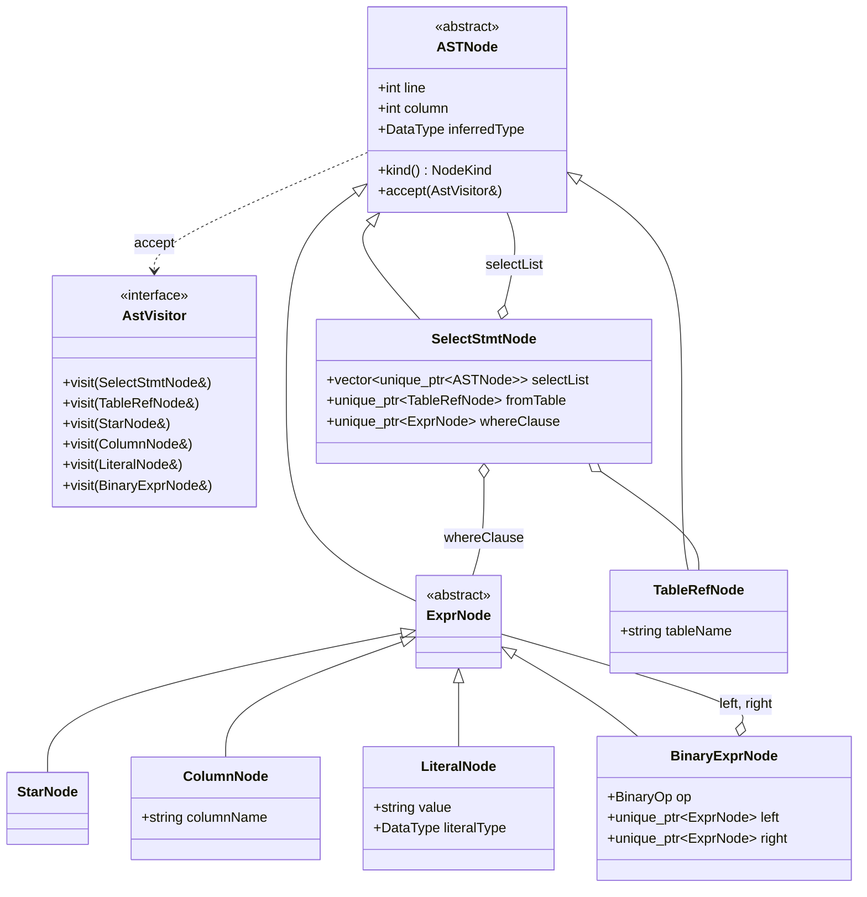

# Arquitectura de Clases del AST

Definidas en `semantic_analyzer/include/ast.h`, dentro del namespace `sem`.

## Clases

- **`ASTNode`** (base abstracta): posición `line`/`column` del token de origen, `inferredType` (la decoración de
  tipos que llena el analizador), `kind()` para distinguir nodos sin `dynamic_cast` y `accept()` del patrón Visitor.
- **`SelectStmtNode`**: raíz de la consulta. `selectList` contiene `ColumnNode` o un `StarNode`; el analizador
  reemplaza el `StarNode` por un `ColumnNode` por cada columna de la tabla, en el orden del catálogo.
  `whereClause` es `nullptr` si no hay `WHERE`.
- **`TableRefNode`**: la tabla del `FROM` (`tableName`).
- **`ExprNode`**: base de todo lo que puede aparecer en proyección o condición.
  - **`StarNode`**: el comodín `*`.
  - **`ColumnNode`**: referencia a una columna (`columnName`); su `inferredType` lo fija el analizador desde el catálogo.
  - **`LiteralNode`**: constante (`value`); su tipo (`INT`, `FLOAT`, `VARCHAR`) es sintáctico y ya viene fijado
    al construirlo (`literalType` / `inferredType`).
  - **`BinaryExprNode`**: comparación (`=`, `<>`, `<`, `>`, `<=`, `>=`) o conectivo lógico (`AND`, `OR`);
    `op` es un `BinaryOp` y su `inferredType` resultante es `BOOLEAN`.

## Decisiones de la jerarquía

- Propiedad con `std::unique_ptr`: el árbol libera todo solo, sin `new`/`delete` manuales.
- Visitor (`AstVisitor`): el `SemanticAnalyzer` recorre el árbol sin que los nodos conozcan la lógica de validación.
- El `ColumnNode` no guarda la tabla: se resuelve contra la tabla del `FROM` (alcance único de la consulta).
